# Configuração das Credenciais do Google para OAuth

Para gerar as credenciais do Google Cloud, você precisa seguir um passo a passo para criar um projeto e configurar a tela de consentimento OAuth. As credenciais permitem que seu aplicativo se comunique com as APIs do Google de forma segura.

> [!IMPORTANT]  
> Utilize **exclusivamente** seu **e-mail pessoal** ao se registrar ou acessar.
> Não utilize seu e-mail acadêmico para este processo.

## Parte 1: Criando o projeto

### 1. Criar um novo projeto

Acesse a página de criação de projetos do Google Cloud através do link: https://console.cloud.google.com/projectcreate

A tela para criar um novo projeto irá aparecer. Dê um nome ao seu projeto, como por exemplo, **"Restaurante IFPB"** e clique em **Criar**.

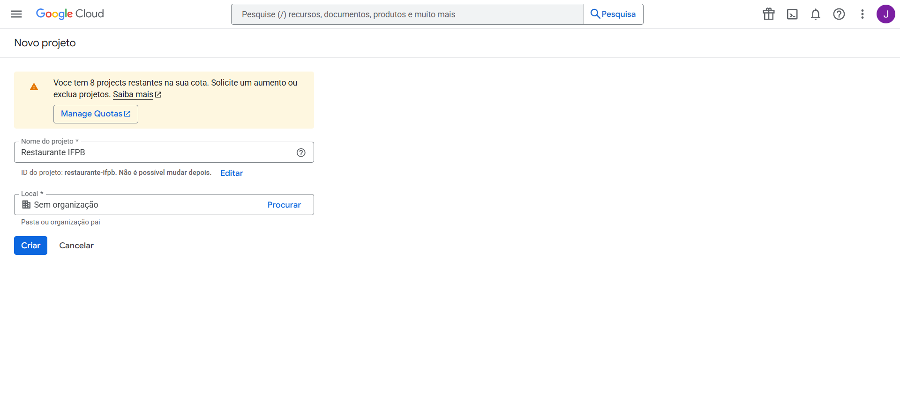

### 2. Selecionar o projeto

Após a criação, uma notificação irá aparecer no canto superior direito da tela. Clique em **Selecionar projeto** para começar a trabalhar nele.

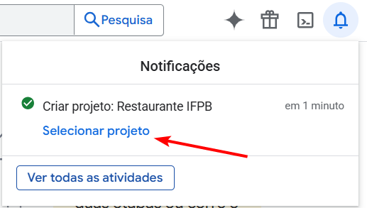

### 3. Acessar a tela de consentimento OAuth

No menu superior esquerdo, clique no ícone de três linhas para abrir o menu lateral.

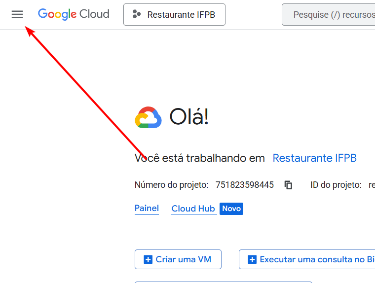

Após acessar o menu lateral do Google Cloud Console, clique em **APIs e serviços** e, em seguida, selecione a opção **Tela de permissão OAuth**.

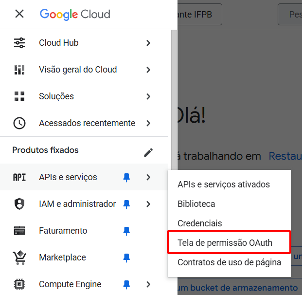

---

## Parte 2: Preenchendo os detalhes do app

Clique em **Vamos começar** para iniciar o processo de configuração.

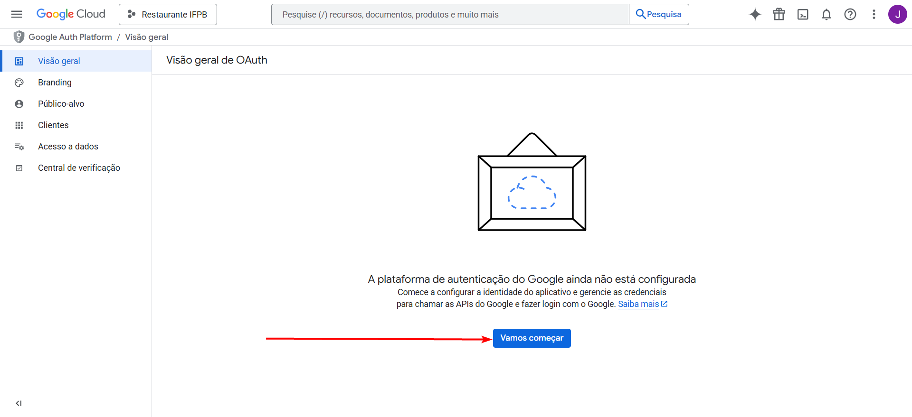

### 1. Preencher informações do aplicativo

Na seção de **Informações do app**, você precisará adicionar alguns detalhes sobre seu projeto.

1.  **Nome do app**: Digite o nome do seu aplicativo (ex.: "Restaurante IFPB").
2.  **E-mail de suporte ao usuário**: Adicione um e-mail para suporte.
3.  Clique em **Avançar**.

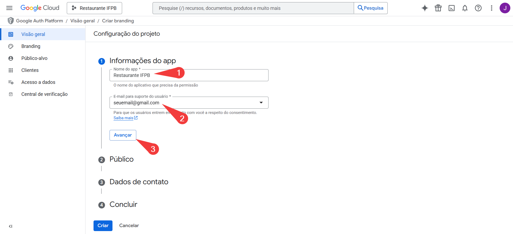

### 2. Definir o tipo de usuário

Selecione **Externo** para que o aplicativo possa ser usado por qualquer usuário com uma Conta Google. Clique em **Avançar**.

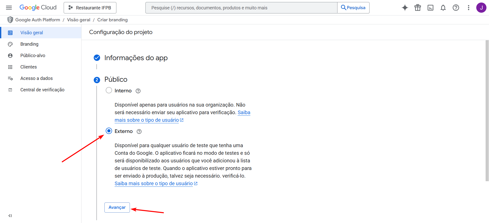

### 3. Adicionar o e-mail de contato do desenvolvedor

Em **Dados de contato**, adicione o e-mail que o Google usará para enviar notificações sobre o projeto. Clique em **Avançar**.

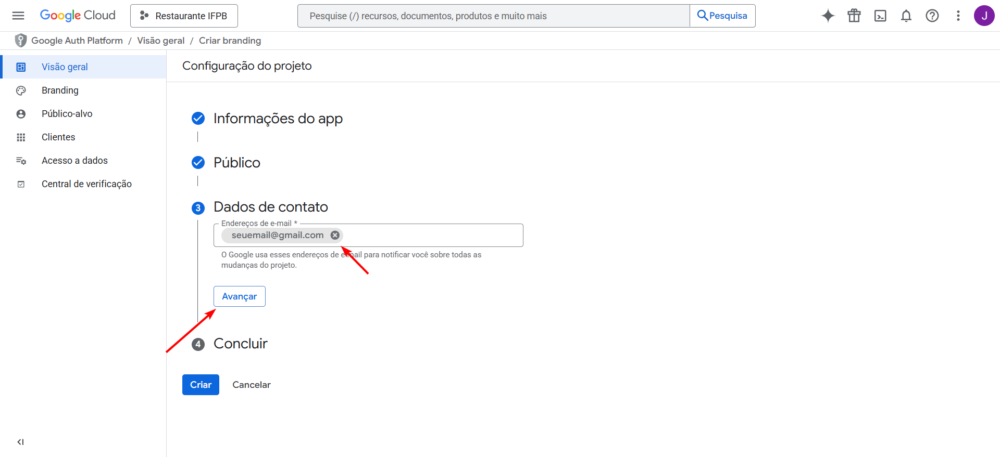

### 4. Concluir a configuração

Na última etapa, você irá revisar as informações. Marque a caixa **Eu concordo com a política de dados do usuário dos serviços de API do Google** e clique em **Criar**.

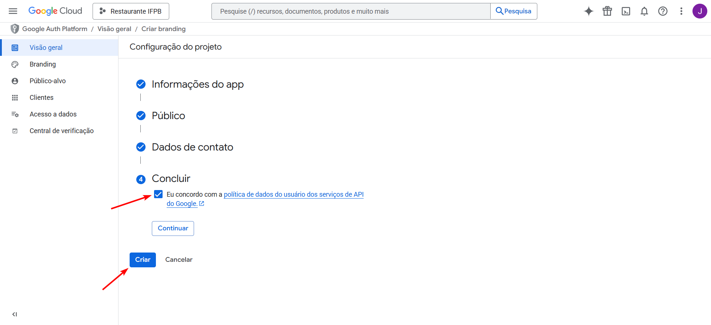

---

## Próximos passos

Agora que o projeto e a tela de consentimento estão configurados, você pode criar as credenciais que irá usar em seu aplicativo. No menu lateral, vá para **APIs e serviços** novamente e selecione **Credenciais**.

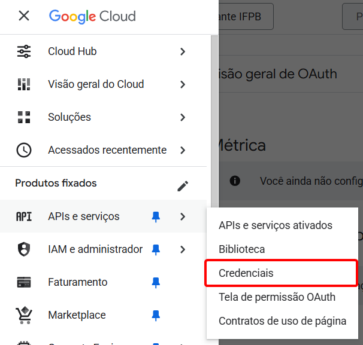

## Parte 3: Criando as credenciais OAuth

### 1\. Criar o ID do cliente OAuth

Clique no botão **+ Criar credenciais** na parte superior da tela e selecione **ID do cliente OAuth** no menu suspenso.

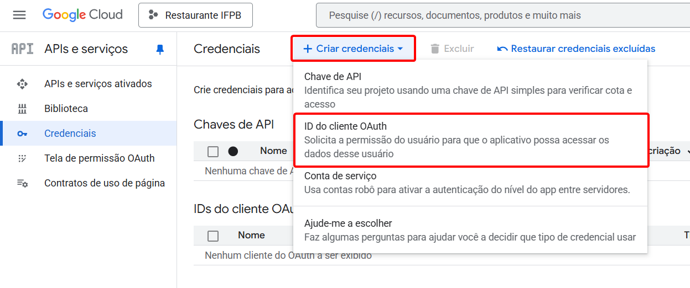

### 2\. Configurar o tipo de aplicativo

Na página **Criar ID do cliente do OAuth**, selecione **Aplicativo da Web** como o tipo de aplicativo. Dê um nome ao seu cliente, por exemplo, **"Cliente Web 1"**.

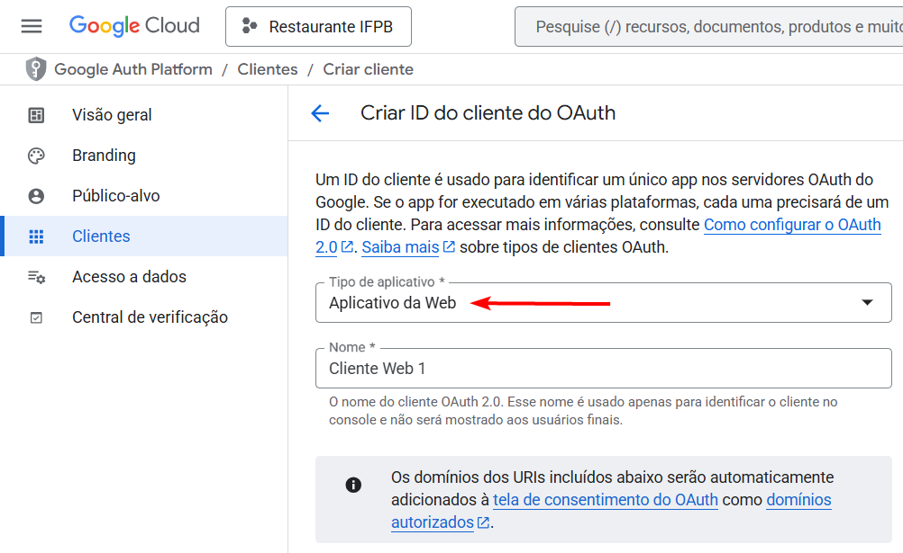

### 3. Adicionar as URLs de origem

Agora, você precisa adicionar as **URIs de Origens JavaScript autorizadas**. Estas são as URLs onde seu aplicativo estará hospedado.

> **Observação:**  
> Escolha uma das opções abaixo conforme onde você está executando o projeto:

> [!NOTE]  
> Caso esteja executando o projeto localmente na sua máquina, adicione as URLs **http://localhost:3000**, **http://localhost:5173** e **http://localhost:4173** como URIs de origem autorizadas.

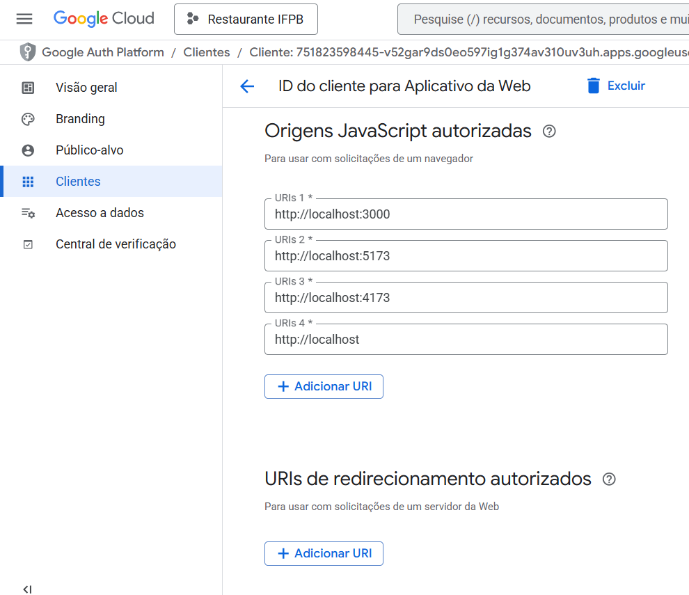

> [!NOTE]  
> Se estiver utilizando o GitHub Codespaces, clique na aba **Portas** para obter as URLs de redirecionamento, que geralmente incluem `*.github.dev`. Adicione essas URLs (com as portas 3000, 5173 e 4173) no campo correspondente.

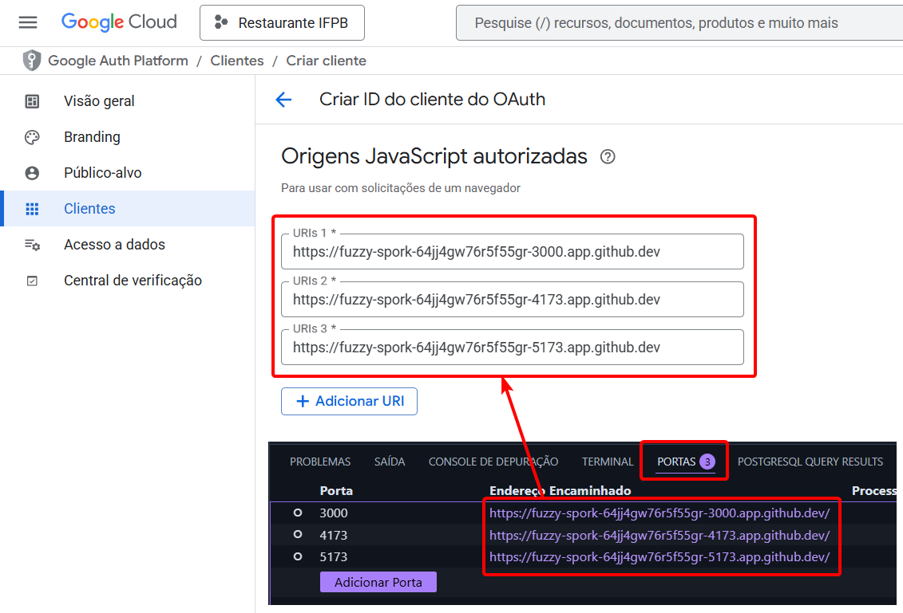

### 4. Adicionar o domínio do OAuth 2.0 Playground

> Este domínio será utilizado para configuração do envio de e-mails.

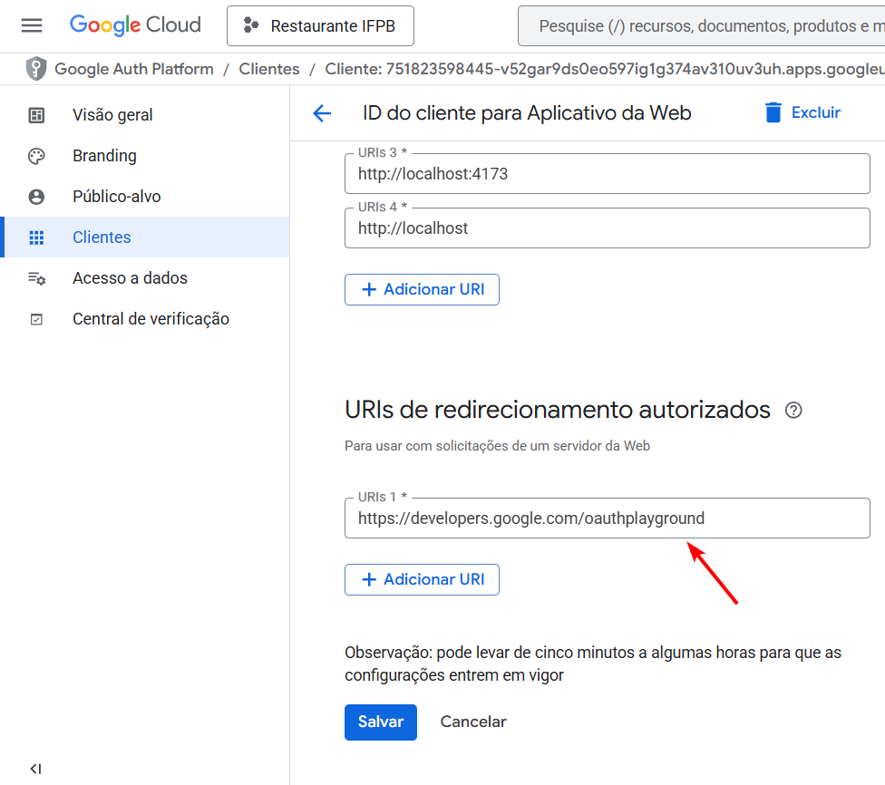

### 5\. Copiar o ID do cliente

Após criar o cliente, uma janela pop-up irá aparecer com o **ID do cliente**. **Copie este ID imediatamente** usando o botão de cópia. Copie também o **Client Secret** e guarde em um local seguro.

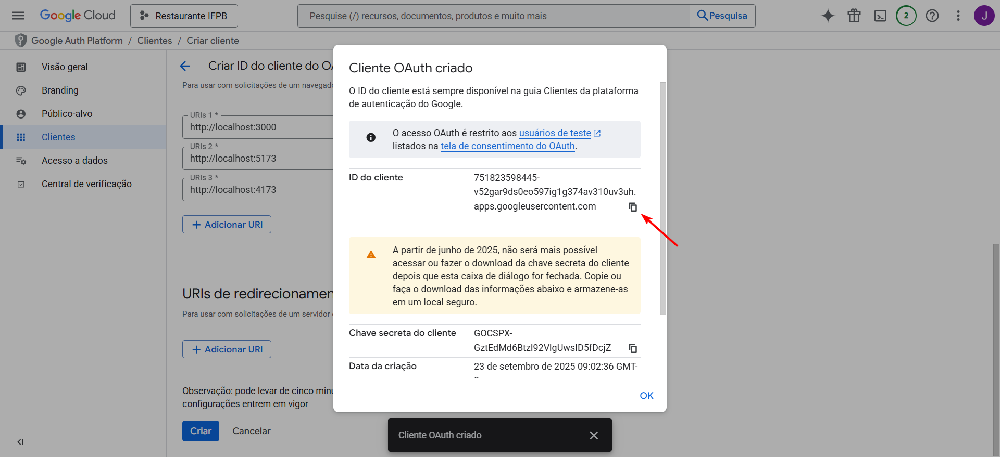

## Parte 4: Configurando o arquivo .env

Para usar o ID do cliente em seu projeto, você precisa armazená-lo em um arquivo de variáveis de ambiente (`.env`).

Tanto na pasta `backend` quanto na pasta `frontend`, crie ou edite o arquivo `.env` e adicione a seguinte variável:

- **Para o backend (servidor)**: Crie uma variável chamada **`GOOGLE_CLIENT_ID`** e atribua o ID do cliente a ela.
- **Para o frontend (cliente)**: Crie uma variável com o prefixo **`VITE_`** (`VITE_GOOGLE_CLIENT_ID`) e atribua o ID do cliente a ela.

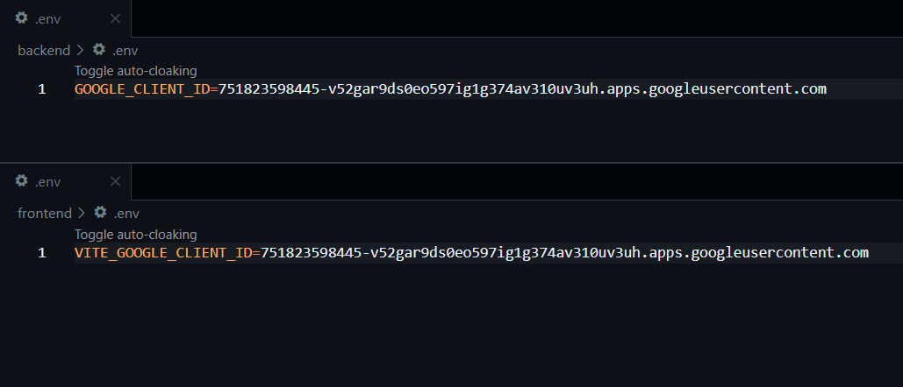

---

[**Próximo passo →**](./002-credenciais-gmail.md)
