# Configuração das Credenciais do Gmail

Passos necessários para configurar envio de e-mails para seu aplicativo no Google Cloud

## 1. Configurar Usuários de Teste

Antes de testar seu aplicativo, você precisa adicionar contas de e-mail como usuários de teste para que elas possam acessar o app enquanto ele estiver em status de "Teste".

1. No Google Cloud Console, navegue até **APIs e serviços > Credenciais**.
2. Clique no cliente que você criou anteriormente (ex: "Cliente Web 1").

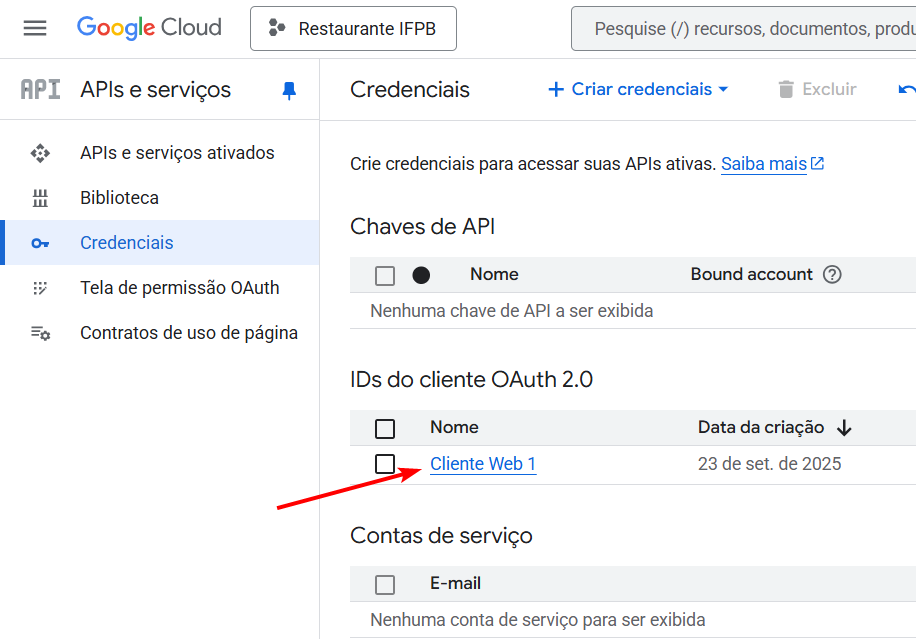

3. Se você estiver usando o GitHub Codespaces, é importante adicionar o domínio do Codespaces como um domínio autorizado na tela de branding. No menu lateral, clique em **Branding** e, em **Domínios autorizados**, adicione **github.dev**.

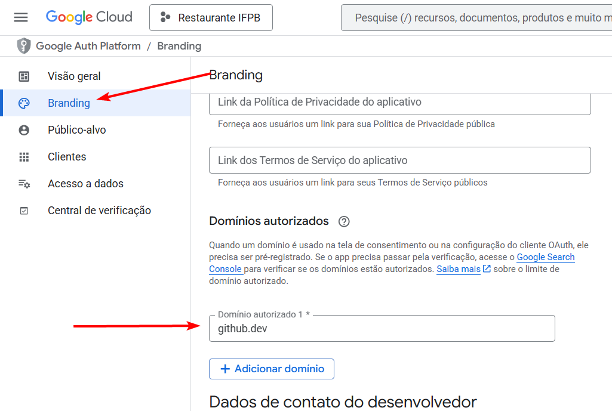

4. No menu lateral, clique em **Público-alvo**. E em seguida, clique em **Add users**

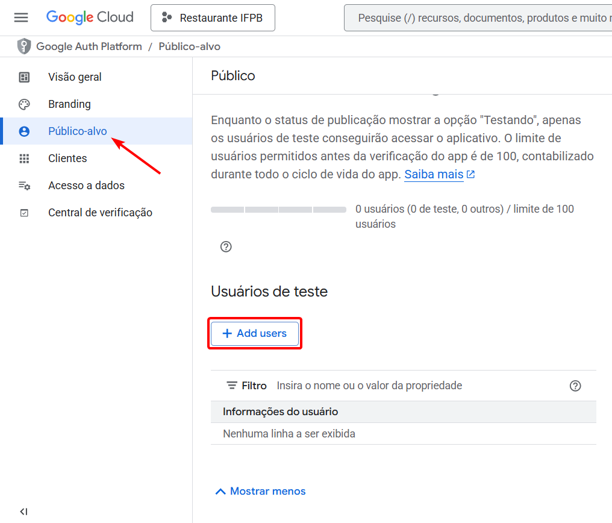

5. Insira o endereço de e-mail da conta Google que você usará para testar o aplicativo e clique em Salvar.

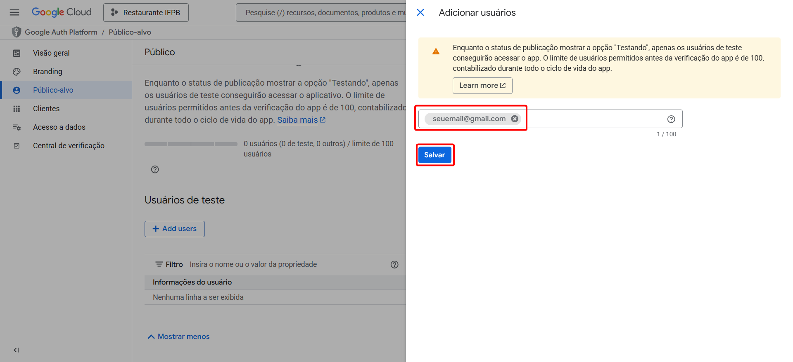

## 2. Gerar Tokens com OAuth 2.0 Playground

O OAuth 2.0 Playground é uma ferramenta útil para testar a autenticação OAuth e gerar tokens. Acesse o OAuth 2.0 Playground: https://developers.google.com/oauthplayground

1. No canto superior direito, clique no ícone de engrenagem para acessar as configurações do OAuth 2.0.
2. Marque a opção Use your own OAuth credentials.
3. Insira ID do cliente que você copiou na documentação de credenciais do Google OAuth no campo **OAuth Client ID**
4. Insira também o **OAuth Client secret** (chave secreta do cliente) que você obteve do seu projeto do Google Cloud.
5. Clique em **Close** para fechar as configurações.

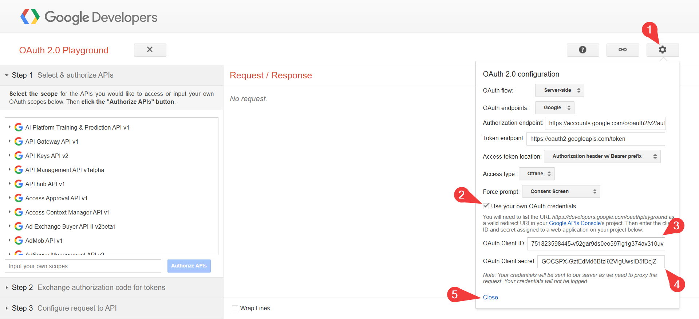

## 3. No **Step 1: Select & authorize APIs**:

1. Selecione a API do Gmail (**Gmail API v1**) e marque o escopo `https://mail.google.com/`.
2. Clique em **Authorize APIs**.

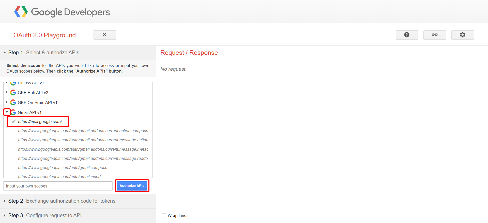

## 4. Tela de consentimento do Google:

1. Se vir a mensagem "O Google não verificou este app", clique em **Continuar**.

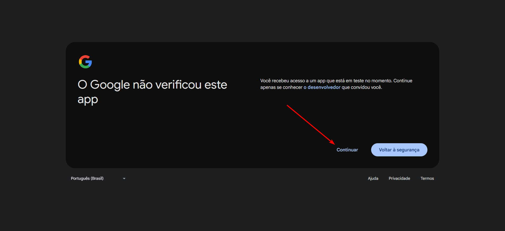

2. Na próxima tela, confirme as permissões solicitadas pelo seu aplicativo e clique em **Continuar**.

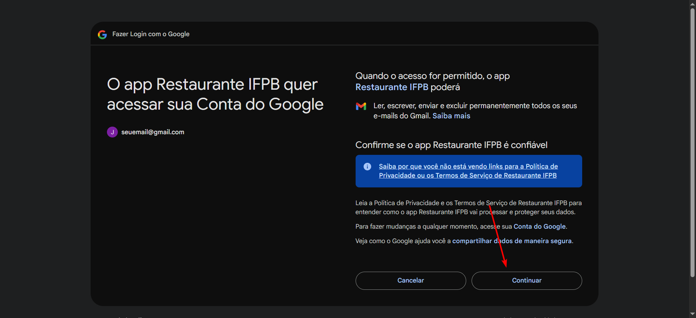

## 5. Authorization code.

Depois que você autoriza o acesso na tela de consentimento do Google, você é redirecionado de volta para o OAuth 2.0 Playground.

Em seguida, é clicado o botão “Exchange authorization code for tokens”, que envia a solicitação ao servidor OAuth do Google.

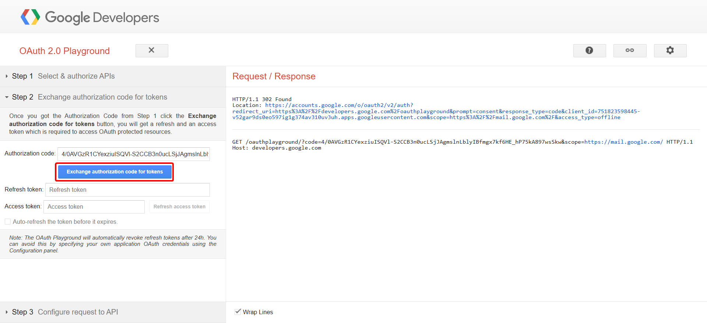

Após obter o Authorization Code na etapa anterior, ele é copiado e inserido no campo indicado.
Em seguida, deve-se clicar em `Step 2 Exchange authorization code for tokens`, conforme mostrado no menu lateral.

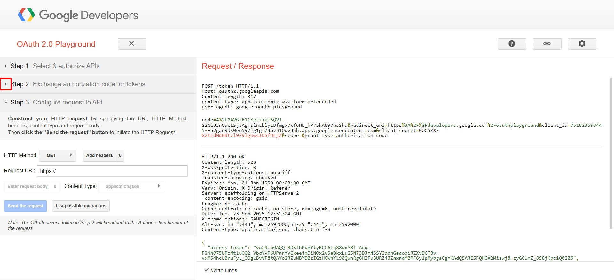

Copie o Refresh Token e salve-o no seu arquivo de variáveis no .env no backend, com o nome GMAIL_REFRESH_TOKEN.

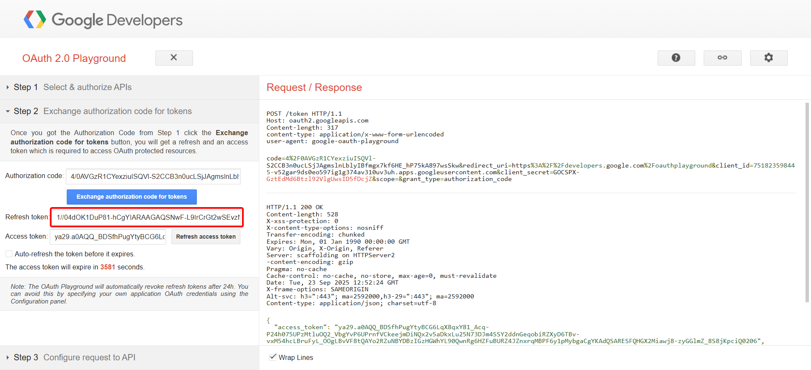

# Configuração Final

1. **Abra o arquivo `.env`** no seu projeto. Se ele não existir, crie na pasta backend.
2. Adicione as seguintes variáveis com os valores correspondentes que você obteve do Google Cloud Console e do OAuth 2.0 Playground:

Seu arquivo `.env` deve ficar parecido com o exemplo abaixo:

```env
GOOGLE_CLIENT_ID=

GMAIL_NAME=
GMAIL_EMAIL=
GMAIL_CLIENT_ID=
GMAIL_CLIENT_SECRET=
GMAIL_REFRESH_TOKEN=
```

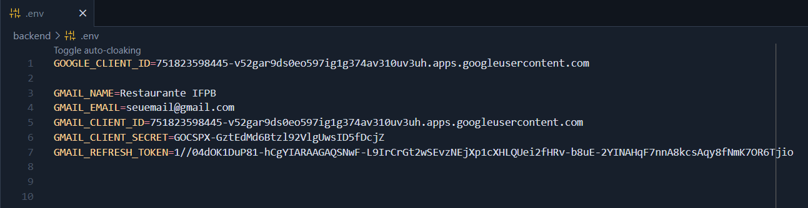
